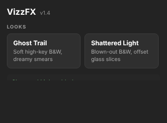

# VizzFX

One-click looks for Premiere Pro. Select a clip, click a look, and VizzFX builds it from Premiere's own effects. Everything stays editable in Effect Controls.



**Looks**
- Ghost Trail: soft black and white, dreamy trails
- Shattered Light: blown-out black and white, diagonal glass slices
- Low Shutter: stepped 6 fps motion with soft smear, fades in from black
- Thermal: heat-camera colors
- Tracking HUD: sci-fi HUD with editable text, keyframe the box to follow a face
- LED Pixel: pixel grid with RGB fringes and glow. Set how many pixel rows you want; works on vertical video too
- Diamond X-Ray: black and white made of sparkling crystals, like an x-ray of diamonds
- Film Grain: fine monochrome grain. The Grain slider adjusts it live on the selected clips (and the grain in other looks)

## Install

Needs Premiere Pro 25.6 or newer.

1. Download [VizzFX.ccx](https://github.com/visuraW/vizzfx/raw/main/dist/VizzFX.ccx).
2. Double-click it and click Install.
3. Restart Premiere and open **Window → UXP Plugins → VizzFX**.

## Use

Select a clip on the timeline and click a look.

VizzFX adds layers on free tracks above your clip, and adds tracks if it needs more. It asks before covering other clips. Cancel changes nothing, and Ctrl/Cmd+Z undoes everything.

**Thermal:** Premiere doesn't let plugins load LUTs. The first time, VizzFX asks where to save `VizzFX_Thermal.cube` (or [download it](https://github.com/visuraW/vizzfx/raw/main/plugin/luts/VizzFX_Thermal.cube) with right-click > Save Link As). Then pick it in Lumetri Color > Basic Correction > Input LUT > Browse, and save the effects as a preset.

**Tracking HUD:** edit the text, box position and size in Window > Essential Graphics. Keyframe Box Center to follow a face. (To change the HUD design, edit `after-effects/build-hud-mogrt.jsx` and re-export it from After Effects.)

**Sliders:** after you click LED Pixel or Diamond X-Ray, its sliders appear under the cards. Moving one updates the selected clips live.

**LED grid gaps:** run `after-effects/build-led-grid-mogrt.jsx` in After Effects once, the same way as the HUD script. Until the grid template is bundled, LED Pixel works without the gaps.

To reuse a look as a preset: select the effects in Effect Controls, right-click, and choose **Save Preset**.

## Problems

Open **Log** in the panel, click **Copy log**, and paste it into an [issue](https://github.com/visuraW/vizzfx/issues).

## Development

Plain HTML/CSS/JS, no build step. Looks are defined in `LOOKS` in `plugin/index.js`.

```bash
./scripts/build.sh                                        # makes dist/VizzFX.ccx
PR26=1 node tests/mock-premiere.js plugin/index.js ghost  # test without Premiere
```

MIT License.
